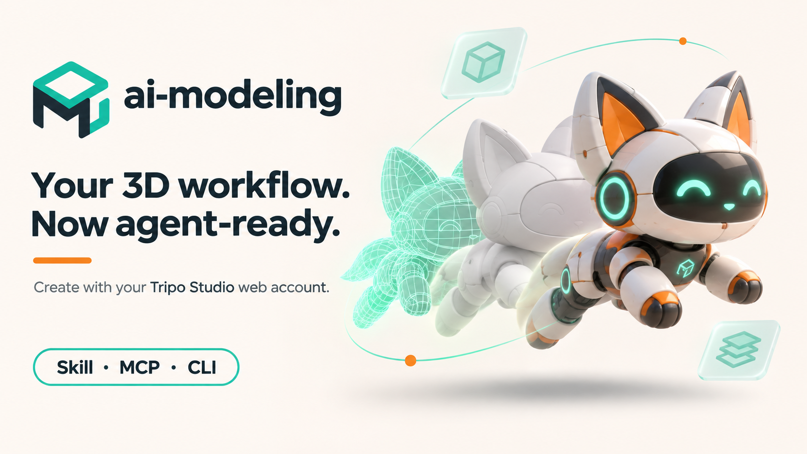

<p align="center">
  
</p>

<h1 align="center">ai-modeling</h1>

<p align="center">
  English · <a href="README.zh-CN.md">简体中文</a>
</p>

<p align="center">
  
</p>

<p align="center">
  <strong>Your 3D workflow. Now agent-ready.</strong><br>
  Turn prompts and reference images into 3D workflows your AI assistant can run.<br>
  Generate, edit, animate, and manage assets through your own Tripo Studio account.
</p>

<p align="center">
  <a href="LICENSE"></a>
  <a href="https://nodejs.org/"></a>
  <a href="docs/development.md"></a>
  <a href="docs/compatibility.md"></a>
  <br>
  <a href="skills/ai-modeling/SKILL.md"></a>
  <a href="#use-with-mcp"></a>
  <a href="docs/commands.md"></a>
  <a href="https://linux.do/"></a>
</p>

<p align="center">
  <a href="#why-ai-modeling">Why ai-modeling</a> ·
  <a href="#what-you-can-build">Features</a> ·
  <a href="#quick-start">Quick start</a> ·
  <a href="#choose-your-interface">Skill / MCP / CLI</a> ·
  <a href="#export-and-share">Export</a> ·
  <a href="#links">Links</a>
</p>

## Why ai-modeling

**Bring your Studio workflow into the tools you already use.** Give an agent the Skill, connect an MCP client, or run the CLI from your own scripts. Each route uses the same execution layer, account profile, and task history.

- **Use your Studio web credits.** Sign in with your own Tripo Studio account; a developer API key is not required.
- **Go beyond the first generation.** Work with images, models, textures, geometry, animation, projects, and Canvas assets.
- **Build the workflow you need.** Choose operations, inputs, and output paths. No mandatory generate → texture → rig pipeline.
- **Keep work recoverable.** Track tasks, inspect results, and resume downloads. Preserve unknown submissions for reconciliation instead of automatically resubmitting.

Community maintained and independent of Tripo. Studio operations may consume credits; supported features and parameter differences are documented in the [compatibility guide](docs/compatibility.md).

## What you can build

| Your goal | Tools you can combine |
| --- | --- |
| Explore an idea | Text-to-image, image references, text/image/multiview-to-model |
| Refine a model | Texturing, retopology, segmentation, UV operations, and supported local edits |
| Prepare motion | Rigging, animation generation, task inspection, and model downloads |
| Organize a project | Studio assets, project history, Canvas nodes, templates, and Lab operations |
| Automate delivery | Structured JSON calls, batch manifests, task recovery, and caller-selected output paths |

Use the [command reference](docs/commands.md) to find the right operation. Some combinations depend on model support, account permissions, or optional local tools.

## Quick start

Install Node.js **24+**, then install the single runtime package from [npm](https://www.npmjs.com/package/@seekskyworld/ai-modeling):

```sh
npm install --global @seekskyworld/ai-modeling@0.1.0
ai-modeling --version
ai-modeling doctor --offline --json
```

The npm package is **`@seekskyworld/ai-modeling`**; its command is **`ai-modeling`**. Choose [Skill](#use-with-a-skill) or [MCP](#use-with-mcp) below. Both use the same CLI and Studio account. An npm installation does not automatically add a Skill or configure an MCP client.

For direct CLI use, connect your account and preview a request:

```sh
ai-modeling setup
ai-modeling make "a small blue robot" --model tripo-p2 --dry-run --json
```

`setup` reuses a valid saved session. When login is needed, complete passwords and verification in the browser; no copied Token is required. Login needs Chrome/Edge and a working system credential store. The dry run is local and does not submit a generation task. To generate, run the reviewed request without `--dry-run`; it uses Studio credits. Use `ai-modeling task get @last` to inspect the task or `ai-modeling task watch @last --download --out ./assets` to download its result.

Prefer no global install? Run a command with `npx --yes --package @seekskyworld/ai-modeling@0.1.0 ai-modeling --version`; use the same full prefix for subsequent CLI or Skill installation commands. The MCP configuration below can use npx directly.

[Installation and login](docs/usage.md#quick-start-in-english) covers npm, [release archives](https://github.com/seekskyworld/ai-modeling/releases), platform requirements and recovery. Source contributors run `npm ci` and `npm run build`, then use `node dist/cli/main.js` in place of `ai-modeling`; building alone does not install a global command. Use `ai-modeling pricing status` to check price provenance and expiry before a paid workflow.

## Choose your interface

| Interface | Best for | What to install |
| --- | --- | --- |
| **Agent Skill** | An assistant that can run local commands | The runtime package + an explicitly selected Skill destination, or import the separate Skill ZIP |
| **MCP** | A client that calls structured tools | The runtime package + an MCP server configuration |
| **CLI** | Terminal workflows, scripts, and automation | The runtime package, or a built source checkout |

The CLI is the underlying execution interface. MCP exposes its operations as tools for an agent: the agent calls MCP, and MCP invokes the CLI internally. Skills provide usage guidance, examples, and pipeline organization for the selected entry point. An agent using MCP stays with MCP tools rather than switching to shell commands. The Skill needs the runtime installed separately; no fixed business workflow is required.

Version 0.1.0 uses the `@seekskyworld/ai-modeling` package, the `ai-modeling` command, `AI_MODELING_*` settings, `ai_modeling_*` tools, and `ai-modeling://auth/status`. Configure clients with these names and complete login through your selected entry point.

### Use with a Skill

After installing the runtime, list the supported clients and install the bundled guidance into your chosen client. This example uses Claude Code; replace the target with your client:

```sh
ai-modeling skill targets
ai-modeling skill install --target claude-code
ai-modeling skill status --target claude-code
```

Reload the client's Skills or start a new session, then ask it to use the `ai-modeling` Skill. Confirm that it can read the installed `SKILL.md` and run `ai-modeling --version`. The Skill is one set of progressively loaded guidance; it does not have separate light and extended editions.

There is no implicit client target: select `--target NAME` or use `--dir` for a custom parent directory, whose `ai-modeling/` child holds the Skill. Named targets use user scope by default, except `golutra-agent`, which supports project scope only and defaults to it. Choose the project with `--project-dir /path/to/project`. Installation requires no Studio login and preserves modified or unmanaged content. The standalone Skill ZIP remains available for manual import. See [client targets, installation and removal](docs/usage.md#安装-skill).

Golutra Agent users can run `ai-modeling skill install --target golutra-agent --project-dir /path/to/project`. The `mcp export --target golutra-agent --out /path/to/new-plugin-export` command also prepares native plugin manifests. Golutra Agent 0.3.9 currently filters MCP tools out of its model tool surface, so successful plugin registration does not enable calls in that version. Use the Skill/CLI route, or revalidate MCP after the host fixes this limitation. See the [Golutra Agent setup](docs/usage.md#golutra-agent).

### Use with MCP

Add this version-pinned configuration to a client that supports `mcpServers`. It uses npm through npx and does not need a separate global install:

```json
{
  "mcpServers": {
    "ai-modeling": {
      "type": "stdio",
      "command": "npx",
      "args": ["--yes", "--package", "@seekskyworld/ai-modeling@0.1.0", "ai-modeling", "mcp"],
      "env": {"AI_MODELING_PROFILE": "default"}
    }
  }
}
```

Reload the MCP client and confirm that it lists six tools and the `ai-modeling://guides/usage` resource. Node.js 24+ and npm must be visible to that client. If a GUI client cannot find npx, configure its absolute executable path. Already installed globally? Use `"command": "ai-modeling"` and `"args": ["mcp"]`, as in the [installed configuration](examples/mcp-installed.json); use the executable's absolute path when needed. Source users have a separate [source configuration](examples/mcp.json). Claude Code, Cursor and the current VS Code Copilot configuration use `mcpServers`; Codex uses the [TOML example](examples/mcp-codex.toml). The [VS Code editor example](examples/mcp-vscode.json) is only for its older `servers` configuration. Follow the [client-specific setup notes](docs/usage.md#mcp-客户端配置); configuration examples do not establish a successful connection in every client.

`ai-modeling mcp` starts the six-tool `default` set, including standalone image generation/editing with GPT Image 2.5 by default. Use the default for everyday image and model creation. For broader Studio asset/editing operations, append `"--toolset", "studio"` to the MCP `args` and restart the server. `full` exposes official-style MCP contracts. MCP invokes the bundled CLI and does not need tokens in its configuration. More [examples and setup notes](examples/README.md) are available.

For the first account operation, a missing session returns `AUTH_REQUIRED` with a login URL. Open that URL, complete login yourself, and let the agent read `ai-modeling://auth/status` until authenticated. It can then continue the original request with its returned request identity. The agent stays with MCP tools; it does not need to copy a Token or run shell commands.

MCP also supplies usage, command and pipeline guidance through `ai-modeling://guides/usage`, `ai-modeling://guides/commands` and `ai-modeling://guides/pipelines`. These resources share their source with the Skill and public command reference. Read the relevant topic and call MCP tools; MCP performs the CLI invocation internally. CLI users can discover the same offline JSON guides with `ai-modeling guides list` and `ai-modeling guides read usage`.

For focused help, start with `ai-modeling://guides/commands/index`, then read a command such as `ai-modeling://guides/commands/model/convert`. CLI equivalents are `guides templates` and `guides read commands/model/convert`. Tool and guide discovery does not open account credentials or create task state.

## Export and share

You can create both distribution formats locally, without publishing a release first:

```sh
# Run in the source directory after npm ci.
npm run export -- --out ../ai-modeling-export

# Or export just the format you need, to a different new directory.
npm run export:skill -- --out ../ai-modeling-skill
npm run export:mcp -- --out ../ai-modeling-mcp
```

The full export contains the Skill ZIP, runtime TGZ, `mcp.json`, `INSTALL.md`, `manifest.json`, and `SHA256SUMS`. Output directories must be outside the source tree, under an existing parent, and must not already exist. Skill-only exports still require a separately installed runtime.

Runtime exports include reviewed portable runtime dependencies, a production shrinkwrap and dependency provenance. npm installs exact-version optional packages for the current platform. The manual release-candidate workflow checks the same TGZ on Linux, macOS and Windows through both the locked `npm ci` installation and npm consumer installation/execution paths. It records dependency integrity separately from functional results; dependency drift blocks release readiness. Missing repository/contact information, source identity, platform reports or valid prices block readiness. See the [distribution guide](docs/development.md#打包与分发). Public releases use the `@seekskyworld/ai-modeling` npm package; releases and source are maintained at [seekskyworld/ai-modeling](https://github.com/seekskyworld/ai-modeling). A local export alone does not publish anything.

## How it fits together

```text
Skills: usage guidance, examples, and pipeline organization
                     ↓ follow the selected entry point
Agent → MCP tools → ai-modeling CLI → Tripo Studio web services
Terminal / scripts ────────→ CLI
```

The CLI owns validation, authentication, task tracking, and downloads. MCP provides usage guidance and examples alongside tools that adapt CLI capabilities; its users do not need to invoke the CLI themselves. Skills load relevant guidance progressively and organize operations through the selected interface without adding a separate backend. Verified web endpoints take priority; behavior performed in the website frontend can have an explicitly documented local equivalent. Some processing needs Blender 4.5+, FFmpeg, or separately supplied conversion resources.

This project does not promise complete official-CLI or website equivalence. Model behavior, permissions, pricing, and upstream endpoints can change. Review [current limitations](docs/compatibility.md) when choosing a workflow.

## Links

- [GitHub repository](https://github.com/seekskyworld/ai-modeling) · [npm package](https://www.npmjs.com/package/@seekskyworld/ai-modeling) · [Releases](https://github.com/seekskyworld/ai-modeling/releases)
- [Getting started](docs/usage.md) — installation, login, and daily use
- [Command reference](docs/commands.md) — CLI commands and structured tools
- [Compatibility](docs/compatibility.md) — supported mappings and known limits
- [Agent Skill](skills/ai-modeling/SKILL.md) — instructions for your assistant
- [Examples](examples/README.md) — MCP configuration and batch manifests
- [Contributing](CONTRIBUTING.md) · [Support](SUPPORT.md) · [Security](SECURITY.md)
- [Roadmap](ROADMAP.md) · [Changelog](CHANGELOG.md)
- [Tripo Studio](https://studio.tripo3d.ai/) — the underlying web service
- [Tripo developer documentation](https://developers.tripo3d.ai/en) — official API/CLI reference; separate from the Studio backend used here
- [Linux.do - community discussion](https://linux.do/)

Detailed guides currently use Simplified Chinese; commands and configuration examples are shared across languages. If this project helps your workflow, consider starring it and sharing what you build.

## License

[Apache License 2.0](LICENSE). Third-party material retains its notices in [NOTICE](NOTICE) and [THIRD_PARTY_NOTICES.md](THIRD_PARTY_NOTICES.md). Tripo services, trademarks, and external assets retain their own terms.
