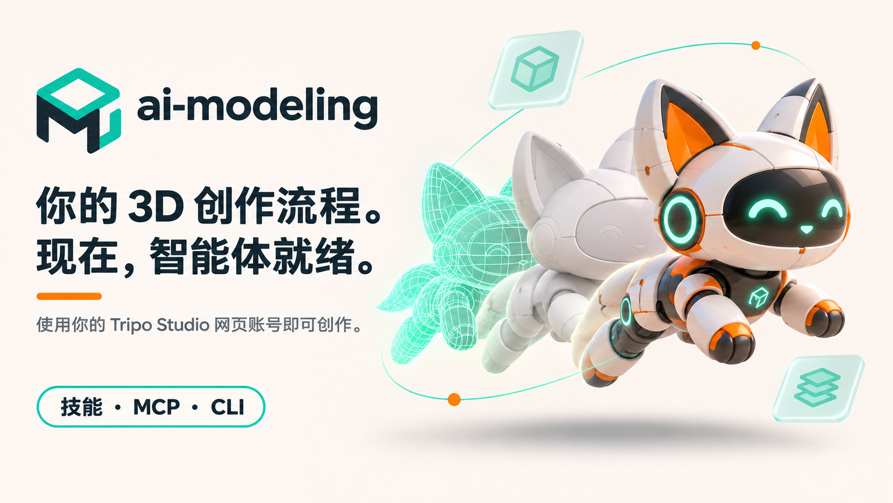

<p align="center">
  
</p>

<h1 align="center">ai-modeling</h1>

<p align="center">
  <a href="README.md">English</a> · 简体中文
</p>

<p align="center">
  
</p>

<p align="center">
  <strong>把你的 3D 创作，接进 AI 工作流。</strong><br>
  从一句描述、一张参考图开始，让 AI 助手调用你的 Tripo Studio。<br>
  生成、编辑、动画与资产管理，按你的需要自由组合。
</p>

<p align="center">
  <a href="LICENSE"></a>
  <a href="https://nodejs.org/"></a>
  <a href="docs/development.md"></a>
  <a href="docs/compatibility.md"></a>
  <br>
  <a href="skills/ai-modeling/SKILL.md"></a>
  <a href="#接入-mcp"></a>
  <a href="docs/commands.md"></a>
  <a href="https://linux.do/"></a>
</p>

<p align="center">
  <a href="#为什么选择-ai-modeling">项目亮点</a> ·
  <a href="#可以做什么">功能</a> ·
  <a href="#快速开始">快速开始</a> ·
  <a href="#选择使用方式">Skill / MCP / CLI</a> ·
  <a href="#导出与分享">导出</a> ·
  <a href="#links">Links</a>
</p>

## 为什么选择 ai-modeling

**把 Studio 的创作能力带进你已经在用的工具。** 给助手安装 Skill，通过 MCP 调用工具，或用 CLI 编排脚本。三种方式共享执行逻辑、账号配置与任务记录。

- **使用已有网页额度。** 登录你自己的 Tripo Studio 账号，无需开发者 API Key。
- **生成之后，还能继续做。** 图片、模型、贴图、几何处理、动画、项目和 Canvas 资产都能进入工作流。
- **流程由你决定。** 自选操作、输入文件和输出位置，不绑定“生成 → 贴图 → 绑骨”的固定步骤。
- **任务可以追踪和恢复。** 保留任务身份、检查结果、恢复下载；提交结果不明时，不自动创建新的收费请求。

这是独立维护的社区项目，与 Tripo 官方无隶属关系。Studio 操作可能消耗积分，支持条件与参数差异见[兼容说明](docs/compatibility.md)。

## 可以做什么

| 你想完成的事 | 可以组合的能力 |
| --- | --- |
| 探索一个创意 | 文生图、图片参考、文字/图片/多视图建模 |
| 继续打磨模型 | 贴图、重拓扑、分割、UV 与受支持的局部编辑 |
| 准备动作 | 骨骼绑定、动画生成、任务检查与模型下载 |
| 整理一个项目 | Studio 素材、项目历史、Canvas 节点、模板与 Lab 操作 |
| 自动化交付 | JSON 调用、批处理清单、任务恢复与自选输出路径 |

具体入口见[命令参考](docs/commands.md)。部分组合取决于模型能力、账号权限或可选本地工具。

## 快速开始

准备 Node.js **24+**，从 [npm](https://www.npmjs.com/package/@seekskyworld/ai-modeling) 安装统一运行包：

```sh
npm install --global @seekskyworld/ai-modeling@0.1.8
ai-modeling --version
ai-modeling doctor --offline --json
```

0.1.0 预发布版存在全局安装原生依赖缺失问题，请使用上方修补版本。

**0.1.8** 新增画布产物验收与会话历史核对，更新审阅价格并明确无预报价操作的费用同意，修复任务恢复与提交守卫。Windows 凭据检查显式加载所需的系统 JSON 模块，保留受控环境、权限检查与超时。详见[更新记录](CHANGELOG.md)及[已验证范围](docs/compatibility.md)。

平台安装与发布结果以对应 [Release](https://github.com/seekskyworld/ai-modeling/releases) 的验收记录为准。安装检查通过不代表浏览器、Agent 宿主或全部 Studio 业务均已验收。

npm 包名是 **`@seekskyworld/ai-modeling`**，命令是 **`ai-modeling`**。接下来选择 [Skill](#使用-skill) 或 [MCP](#接入-mcp)，两者共用 CLI 和 Studio 账号。npm 安装不会自动导入 Skill 或修改客户端 MCP 配置。

直接使用 CLI 时，先连接账号，再预览请求：

```sh
ai-modeling setup
ai-modeling make "a small blue robot" --model tripo-p2 --dry-run --json
```

`setup` 会复用已保存的有效会话；需要登录时，由你在 Chrome/Edge 中完成密码与验证，不需要复制 Token。会话使用本地私有 JSON 文件保存，同一 OS 用户和 profile 的 CLI/MCP 共用，不再依赖系统钥匙串。权限要求和旧版升级见[本地 JSON 凭据](docs/usage.md#本地-json-凭据)。预览只在本地执行；确认后去掉 `--dry-run` 才会生成并消耗 Studio 积分。用 `ai-modeling task get @last` 查询任务，或用 `ai-modeling task watch @last --download --out ./assets` 下载结果。

不想全局安装时，可运行 `npx --yes --package @seekskyworld/ai-modeling@0.1.8 ai-modeling --version`；后续 CLI 或 Skill 安装命令沿用这个完整前缀。下方 MCP 配置也可直接通过 npx 启动。

更多 npm、[Release 归档](https://github.com/seekskyworld/ai-modeling/releases)、平台条件与恢复方法见[安装与登录指南](docs/usage.md)。源码贡献者执行 `npm ci`、`npm run build`，再用 `node dist/cli/main.js` 替换文中的 `ai-modeling`；单纯构建不会安装全局命令。付费流程前可用 `ai-modeling pricing status` 检查价格来源与到期时间。

### 预览生图和建模参数

使用可重复的 `-p key=value` 指定生成参数。固定图片像素尺寸的键是 `size=宽x高`；默认 GPT Image 2.5 支持下面的正方形尺寸：

```sh
ai-modeling generate text-to-image "a small blue toy robot" -p size=1024x1024 --dry-run --json
```

图片建模时，把 `./reference.png` 换成你的输入图片。以下参数明确指定 8,000 面、生成纹理、不追加 PBR：

```sh
ai-modeling generate image-to-model ./reference.png --model tripo-v3.1 -p face_limit=8000 -p texture=true -p pbr=false --dry-run --json
```

两条命令只校验并展示计划，不上传或提交生成；离线报价未知不代表免费。更多键名见[图片参数](docs/commands.md#ai-modeling-studio-image)和[模型参数](docs/commands.md#ai-modeling-studio-model)，也可运行 `ai-modeling guides read commands/studio/model` 按需阅读已安装指南。根据所选模型校验参数，串联生图与建模时保留每一步真实任务的身份。

## 选择使用方式

| 入口 | 适合场景 | 需要安装 |
| --- | --- | --- |
| **Agent Skill** | 能执行本机命令的 AI 助手 | 运行包 + 明确选择的 Skill 安装位置，或导入独立 Skill ZIP |
| **MCP** | 通过结构化工具调用的客户端 | 运行包 + MCP 服务配置 |
| **CLI** | 终端、脚本和自动化任务 | 运行包，或已构建的源码 |

CLI 是底层执行接口；MCP 是面向 Agent 的工具入口，Agent 调用 MCP 后，由 MCP 内部调用 CLI。Skills 提供使用说明、示例和面向具体目标的流程指导，沿用用户选定的入口。选择 MCP 时使用 MCP 工具，不擅自改成 shell CLI。Skill 需要另装运行包，运行层不强制固定业务流程。

0.1.8 使用 `@seekskyworld/ai-modeling` 包名、`ai-modeling` 命令、`AI_MODELING_*` 配置、`ai_modeling_*` 工具及 `ai-modeling://auth/status` 资源。请按这些名称配置客户端，再通过所选入口完成登录。

### 使用 Skill

安装运行包后，先查看支持的客户端，再安装随包指导文件。下面以 Claude Code 为例，使用时替换为自己的客户端：

```sh
ai-modeling skill targets
ai-modeling skill install --target claude-code
ai-modeling skill status --target claude-code
```

安装后刷新客户端的 Skill 列表或新建会话，让 Agent 使用 `ai-modeling` Skill，并确认它可以读取安装后的 `SKILL.md`、执行 `ai-modeling --version`。Skill 只有一套，按需加载参考资料，不分轻量版和扩展版。

不隐式选择客户端：使用 `--target NAME` 指定目标，或用 `--dir` 指定父目录，在其 `ai-modeling/` 子目录中安装 Skill。命名目标一般默认为用户范围；`golutra-agent` 仅支持项目范围，并默认使用该范围，可通过 `--project-dir /path/to/project` 选择项目。此操作无需登录 Studio，并保留被修改或非本工具管理的内容。也可手动导入独立 Skill ZIP；各客户端目标、更新与卸载见[Skill 安装说明](docs/usage.md#安装-skill)。

Golutra Agent 用户可执行 `ai-modeling skill install --target golutra-agent --project-dir /path/to/project`。另提供 `ai-modeling mcp export --target golutra-agent --out /path/to/new-plugin-export` 准备原生插件清单。Golutra Agent 0.3.9 会从模型工具面过滤 MCP 工具，注册成功仍不能调用；当前可用 Skill/CLI 路线，MCP 须待宿主修复后复验。详见 [Golutra Agent 接入](docs/usage.md#golutra-agent)。

### 接入 MCP

在支持 `mcpServers` 的客户端中添加以下固定版本配置。它通过 npx 使用 npm 包，不需要另做全局安装。Windows 宿主若不能启动 npm 的 `.cmd` 脚本，可用 [Windows npx 示例](examples/mcp-npx-windows.json)；直接用 Node.js 启动已安装包的方式见 [Windows 配置说明](docs/usage.md#windows-启动方式)。

```json
{
  "mcpServers": {
    "ai-modeling": {
      "type": "stdio",
      "command": "npx",
      "args": ["--yes", "--package", "@seekskyworld/ai-modeling@0.1.8", "ai-modeling", "mcp"],
      "env": {"AI_MODELING_PROFILE": "default"}
    }
  }
}
```

刷新 MCP 客户端，确认发现6个工具和 `ai-modeling://guides/usage` 资源。该客户端必须能找到 Node.js 24+ 与 npm；GUI 找不到 npx 时填写其绝对路径。已经全局安装时，可改为 `"command": "ai-modeling"`、`"args": ["mcp"]`，见[安装后配置](examples/mcp-installed.json)；必要时使用命令绝对路径。源码用户参考独立的[源码配置](examples/mcp.json)。Claude Code、Cursor 和当前 VS Code Copilot 配置使用 `mcpServers`；Codex 使用 [TOML 示例](examples/mcp-codex.toml)。[VS Code 编辑器示例](examples/mcp-vscode.json) 仅适用于旧的 `servers` 配置。具体位置与差异见[客户端配置说明](docs/usage.md#mcp-客户端配置)；示例本身不代表所有客户端已连接实测通过。

`ai-modeling mcp` 默认启动包含6个工具的 `default` 集，已提供独立生图/图像编辑，默认模型为 GPT Image 2.5；日常生图和建模使用默认集；需要完整资产与编辑入口时，在 MCP `args` 末尾追加 `"--toolset", "studio"` 并重启服务。`full` 提供官方风格的 MCP 合同。MCP 调用同包 CLI，无需把 Token 写进配置；更多说明见[示例目录](examples/README.md)。

首次账号操作缺少会话时，工具返回 `AUTH_REQUIRED`、登录 URL 和 `login_id`。由你打开该链接并完成登录，Agent 读取 `ai-modeling://auth/status`，核对同一个 `login_id` 的流程已完成，再用返回的原请求身份继续操作。该资源只是登录流程快照，`authenticated: true` 不代表当前凭据可读或远端会话仍可用；接续工具会检查认证并返回实际问题。整个过程沿用 MCP，不要求 Agent 改跑 shell 或复制 Token。

MCP 同时通过 `ai-modeling://guides/usage`、`ai-modeling://guides/commands` 和 `ai-modeling://guides/pipelines` 提供使用说明、命令参考与流程示例，内容与 Skill 和公开命令文档同源。Agent 按需读取主题并调用 MCP 工具，CLI 调用由 MCP 内部完成。CLI 用户可通过 `ai-modeling guides list` 和 `ai-modeling guides read usage` 获取相同的离线 JSON 指南。

具体操作可先读 `ai-modeling://guides/commands/index`，再读 `ai-modeling://guides/commands/model/convert` 等分片；CLI 对应 `guides templates` 与 `guides read commands/model/convert`。工具和指南发现不访问凭据或创建任务状态。

## 导出与分享

无需先发布版本，可以直接从源码导出两种交付格式：

```sh
# 在源码目录执行，先完成 npm ci。
npm run export -- --out ../ai-modeling-export

# 也可单独导出，各自选择一个新目录。
npm run export:skill -- --out ../ai-modeling-skill
npm run export:mcp -- --out ../ai-modeling-mcp
```

全部导出包含 Skill ZIP、运行包 TGZ、`mcp.json`、`INSTALL.md`、`manifest.json` 和 `SHA256SUMS`。输出目录须位于源码之外、尚不存在，且父目录已存在。单独导出 Skill 后，使用者仍需另外安装运行包。

运行包随附已审阅的可移植生产依赖、生产 shrinkwrap 和依赖溯源，原生包及其平台依赖由 npm 安装。CI 矩阵面向 Linux、macOS、Windows，各平台须有实际结果；归档安装、本地 npm 安装、全局 npm 安装和 npm exec/npx 分别验收，本地或 npx 通过不能代表全局安装可用。依赖完整性与功能结果分别记录，依赖漂移会阻塞发布就绪；候选流程准备说明和报告，不自动发布。仓库地址、私密联系渠道、来源提交、平台报告或价格有效期不足时保留阻塞项。维护流程见[分发指南](docs/development.md#打包与分发)。公开 npm 包使用 `@seekskyworld/ai-modeling` 名称；源码与 Release 位于 [seekskyworld/ai-modeling](https://github.com/seekskyworld/ai-modeling)。本地导出本身不执行发布。

维护者配置 npm Trusted Publisher 后，可使用[版本标签发布工作流](docs/development.md#自动-npm-发布)。手动触发仅预演；新提交须由三平台验证同一归档，公开 npm 实际下载字节匹配后才确认发布完成。已受理或结果未知的提交保留原归档，继续核对而不重新上传。

## 它如何工作

```text
Skills：使用说明、示例与流程指导
                 ↓ 沿用选定入口
Agent → MCP 工具 → ai-modeling CLI → Tripo Studio 网页服务
终端 / 自动化脚本 ──────────→ CLI
```

CLI 统一负责参数校验、登录、任务跟踪与下载；MCP 提供说明、示例与流程指导，同时把 CLI 能力适配为工具，使用 MCP 的 Agent 不需要自行调用 CLI。Skills 渐进加载相关指导并组织所选入口的操作，不另建后端。优先调用已验证的网页接口；属于网页前端计算的功能，可以提供明确标注的本地对应实现。部分处理需要 Blender 4.5+、FFmpeg 或另行提供的转换资源。

当前不承诺全部官方 CLI 或网页效果等价。模型、权限、价格与上游接口可能变化，选择流程时请查阅[当前限制](docs/compatibility.md)。

## Links

- [GitHub 仓库](https://github.com/seekskyworld/ai-modeling) · [npm 包](https://www.npmjs.com/package/@seekskyworld/ai-modeling) · [Releases](https://github.com/seekskyworld/ai-modeling/releases)
- [使用指南](docs/usage.md) — 安装、登录与日常使用
- [命令参考](docs/commands.md) — CLI 命令和结构化工具
- [兼容说明](docs/compatibility.md) — 网页映射与已知限制
- [Agent Skill](skills/ai-modeling/SKILL.md) — 助手操作说明
- [示例目录](examples/README.md) — MCP 配置与批处理清单
- [贡献指南](CONTRIBUTING.md) · [支持](SUPPORT.md) · [安全](SECURITY.md)
- [路线图](ROADMAP.md) · [更新记录](CHANGELOG.md)
- [Tripo Studio](https://studio.tripo3d.ai/) — 底层网页服务
- [Tripo 开发者文档](https://developers.tripo3d.ai/en) — 官方 API/CLI 参考，与本项目使用的 Studio 后端分开
- [Linux.do - community discussion](https://linux.do/)

如果这个项目帮到了你的工作流，欢迎 Star，也欢迎分享你用它做出的作品和具体使用场景。

## 许可证

[Apache License 2.0](LICENSE)。第三方材料保留 [NOTICE](NOTICE) 与 [THIRD_PARTY_NOTICES.md](THIRD_PARTY_NOTICES.md) 中的声明。Tripo 服务、商标与外部资源仍适用各自条款。
